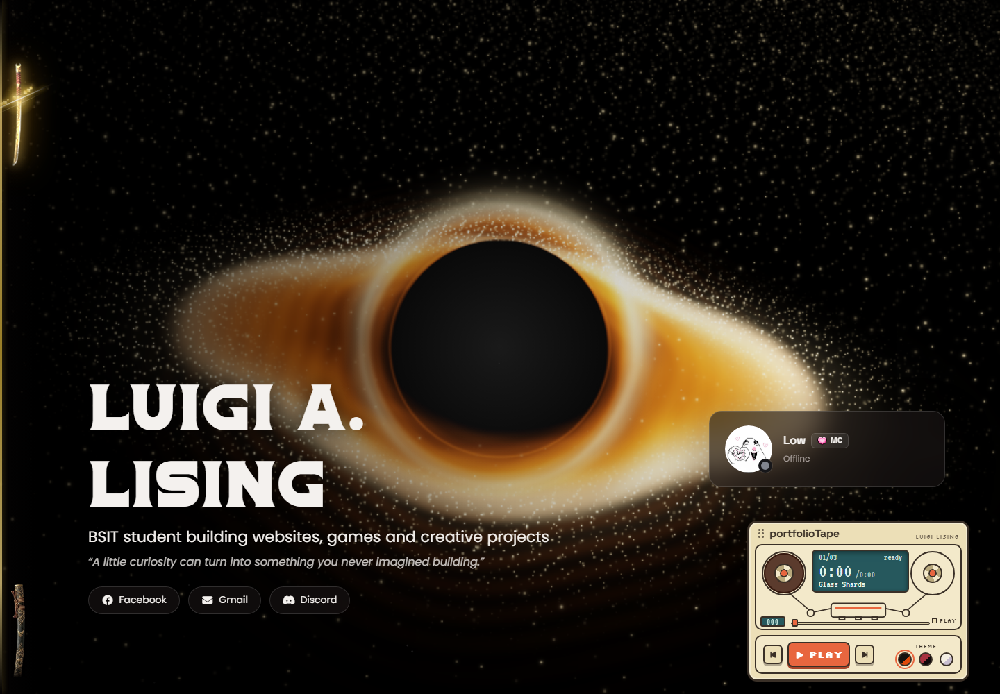

# Luigi A. Lising — Portfolio

A static, single-page personal portfolio showcasing web development work, interests, and a small browser-based arcade.



## Features

- Dark, red, and light themes with animated hero backgrounds
- About, skills, and interests sections
- Music player and live Discord presence card
- Arcade with Snake, Flip the Coin, Memory, and Poly Rush

## Clone and run locally

Replace `<repository-url>` with the GitHub clone URL once one exists. The site has no build step or package installation:

```sh
git clone <repository-url> Portfolio-101
cd Portfolio-101
python -m http.server 8000
```

Open `http://localhost:8000`. This example requires Python; any static file server can be used instead. An internet connection is needed for the externally hosted fonts, Font Awesome, Three.js, and Discord presence service.

## Deploy with Vercel

The arcade leaderboard uses the Vercel function at `/api/leaderboard` and a Neon Postgres database:

1. Run [`database/leaderboard.sql`](database/leaderboard.sql) against the Neon database.
2. In Vercel project settings, add `DATABASE_URL` with that database's connection string for each environment you deploy.
3. Redeploy after setting the environment variable.

The arcade reports the leaderboard as unavailable if the function or database cannot be reached. Player preferences, sound settings, and personal-best displays remain in the browser; shared leaderboard scores are stored online.

## Publish a static copy with GitHub Pages

Open **Settings → Pages**, choose **Deploy from a branch**, select the branch containing the site and the **/(root)** folder, then save. The entry point is `index.html` at the repository root. GitHub Pages does not run the leaderboard API, so use Vercel for online leaderboard support.

## Before making the repository public

- Confirm that the contact/social links and Discord user ID already present in the page are intended to be public.
- Review the image, cover-art, game-art, model, and music sources and permissions listed in [CREDITS.md](CREDITS.md). Their provenance is not fully recorded in this project.
- No `LICENSE` file is included. This project does not grant reuse or redistribution rights; choose and add a license only after the rights to included assets are clear.

## Project layout

- `index.html`, `style.css`, `script.js` — portfolio entry point and core presentation
- `arcade.js`, `arcade.css`, `game/` — arcade interface and Poly Rush game
- `interests.js`, `interests.css`, `pearl.css` — interests section and theme styling
- `hero-bg.js`, `red-hero.js`, `pearl.js` — theme backgrounds loaded dynamically
- `images/`, `memitem/`, `resources/`, `music/` — site media and game assets
- `screenshots/` — repository preview image

The optional model conversion helper in `game/polyrush/convert.mjs` imports Three.js; its package setup is not included.

## Customization

- **Themes and backgrounds:** theme selection is in `script.js`; theme colors and background image paths are in `style.css`. The animated theme backgrounds are `hero-bg.js`, `red-hero.js`, and `pearl.js`, with light-theme styling in `pearl.css`.
- **Sword and sheath artwork:** per-theme image paths and sizing are configured in `script.js`. Replace the corresponding files in `images/`: `Katana_1.png` and `Sheath_1.png` (dark), `katana-red.png` and `sheath-red-v2.png` (red), or `katana-light.png` and `sheath-light-v2.png` (light).
- **Profile card:** the card markup is in `index.html`, its appearance is in `style.css`, and live Discord data is handled by `discord-presence.js`.
- **Music:** edit the `MUSIC` list in `script.js` and place the audio files under `music/` (currently `song1.mp3`, `song2.mp3`, and `song3.mp3`).
